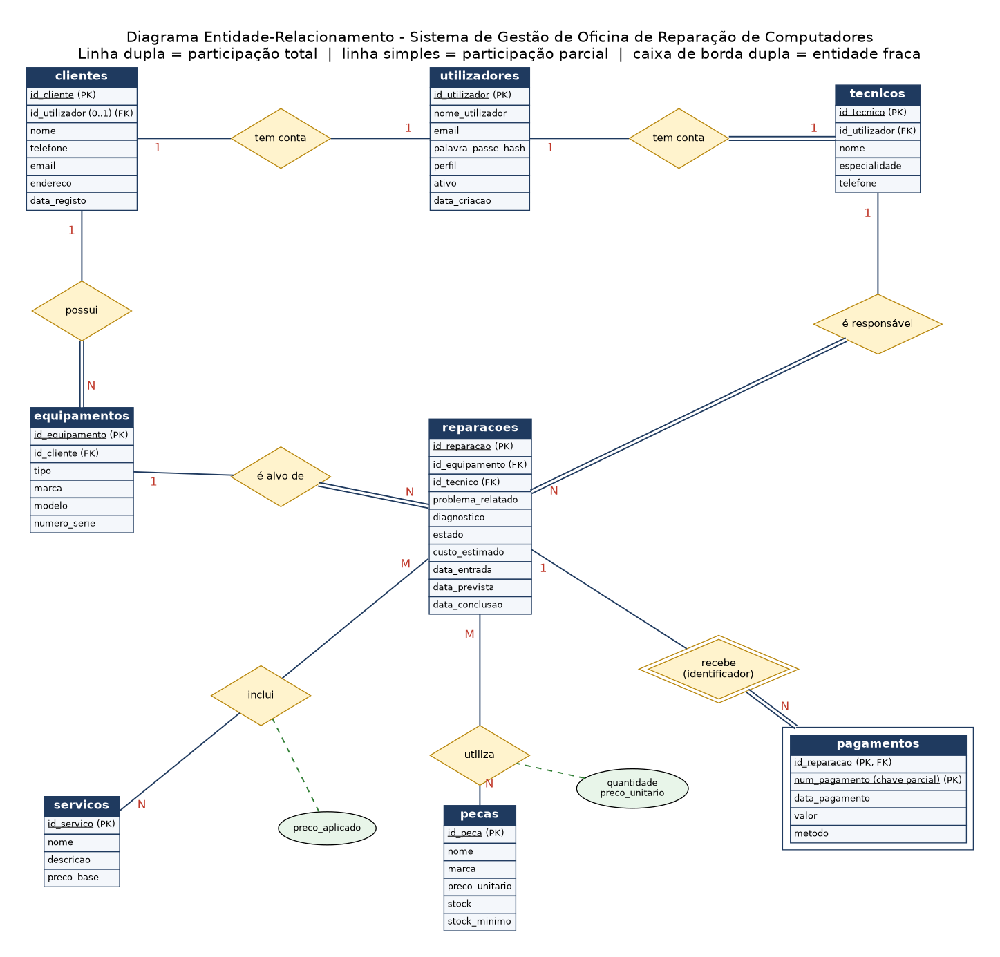

# Sistema de Gestão de Oficina de Reparação de Computadores

| **Estudante** | Faria Fernando Gua |
| **Curso** | Licenciatura em Informática, 2.º ano |
| **Unidade curricular** | Tecnologias de Bases de Dados |
| **Instituição** | Universidade Licungo |
| **Docente** | Daniel Gimo_ |
| **Data de entrega** |22 de outubro de 2026 |
| **Vídeo de demonstração** | _(colar aqui o link do YouTube)_ |

## 1. Tema escolhido e porquê

Sistema de gestão de oficina de reparação de computadores. Escolhi este tema porque é um serviço do quotidiano com processos bem definidos (receber, diagnosticar, reparar, cobrar e entregar) e porque posso desenvolvê-lo depois no projecto de Programação Web.

## 2. Descrição do problema

Uma oficina de informática recebe computadores, portáteis e outros equipamentos para diagnóstico e reparação. Hoje o controlo é feito em papel, o que causa perda de informação, dificuldade em saber o estado de cada reparação e falta de controlo do stock de peças e dos pagamentos.

O sistema pretende registar o cliente e o equipamento que entrega. Cada entrada gera uma reparação, com o problema relatado, a data de entrada e um técnico responsável. O técnico regista o diagnóstico e actualiza o estado até à entrega. Durante o trabalho, são registados os serviços efectuados (por exemplo, formatação ou limpeza) e as peças usadas, com o respectivo preço. O cliente pode pagar em prestações, e o sistema calcula quanto falta pagar. O administrador gere utilizadores, serviços e stock.

## 3. Regras de negócio

1. Um cliente pode ter vários equipamentos; cada equipamento pertence a um só cliente.
2. Um equipamento pode ter várias reparações ao longo do tempo; cada reparação refere-se a um só equipamento.
3. Cada reparação tem um técnico responsável; um técnico pode ter várias reparações.
4. Uma reparação pode incluir vários serviços, e um serviço pode ser usado em várias reparações.
5. Uma reparação pode usar várias peças, e uma peça pode ser usada em várias reparações. Guarda-se a quantidade e o preço no momento do uso.
6. Uma reparação pode ter vários pagamentos, sempre ligados a uma reparação existente.
7. O stock de uma peça nunca pode ser negativo.
8. Preços, quantidades e valores pagos têm de ser positivos.
9. Estados da reparação, por ordem: **Recebida** → **Em diagnóstico** → **Em reparação** → **Concluída** (trabalho pronto) → **Entregue** (o cliente levou o equipamento).
10. Cada técnico tem uma conta de utilizador; um cliente pode ter conta (para consultar as suas reparações online) ou ser apenas registado ao balcão. Cada conta tem um perfil: administrador, técnico ou cliente.
11. Não se elimina um cliente, equipamento ou reparação que tenha registos dependentes.

## 4. Sistema web previsto (projecto de Programação Web)

Esta base de dados será o suporte do sistema web da disciplina de Programação Web, com três tipos de utilizadores:

- **Administrador:** gere utilizadores, técnicos, serviços e stock de peças; consulta relatórios (reparações por estado, pagamentos, peças com stock baixo).
- **Técnico:** vê as reparações que lhe foram atribuídas, regista o diagnóstico, actualiza o estado e regista serviços e peças usados.
- **Cliente:** cria conta, inicia sessão, consulta os seus equipamentos, o estado das reparações, o custo estimado, os pagamentos e o valor por pagar.

Os pagamentos serão apenas registados no sistema (presencialmente); não haverá pagamento online.

## 5. Diagrama ER e modelo relacional

- Diagrama: [`diagrama_er.png`](diagrama_er.png)
- Modelo relacional, dicionário de dados e estados: [`modelo_relacional.md`](modelo_relacional.md)



## 6. Estrutura do repositório

```
sistema-gestao-oficina-reparacao-computadores/
├── README.md
├── diagrama_er.png
├── modelo_relacional.md
├── 01_criacao_e_insercao.sql
└── 02_manipulacao.sql
```

## 7. Como executar

Requisito: **MySQL 8.0.16 ou superior** (por causa das restrições `CHECK`).

1. Abrir o MySQL Workbench e ligar ao servidor local.
2. Abrir `01_criacao_e_insercao.sql` e executar tudo. **Atenção:** o script apaga e recria a base de dados `oficina_reparacoes`. No fim mostra a contagem de registos de cada tabela.
3. Abrir `02_manipulacao.sql` e executar. O último comando provoca, de propósito, o erro 1452 do teste de integridade (ver comentários no ficheiro).
4. Para repetir os testes de raiz, executar outra vez o ficheiro 01.

Pela linha de comandos: `mysql -u root -p < 01_criacao_e_insercao.sql`

## 8. Conteúdo da base de dados

10 tabelas, todas com pelo menos 20 registos, com dados fictícios e coerentes:

| Tabela | Registos |
|---|---|
| utilizadores | 39 |
| clientes | 21 |
| tecnicos | 20 |
| equipamentos | 20 |
| servicos | 20 |
| pecas | 20 |
| reparacoes | 24 |
| servicos_reparacao | 37 |
| pecas_reparacao | 21 |
| pagamentos | 22 |

Todos os dados são reais. A palavra-passe de demonstração das contas é `Demo@2026` (guardada com SHA2 no script).
